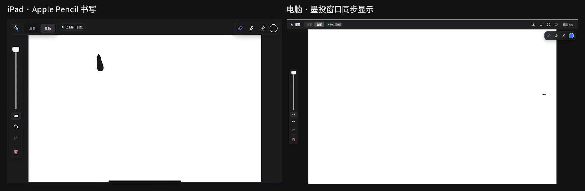
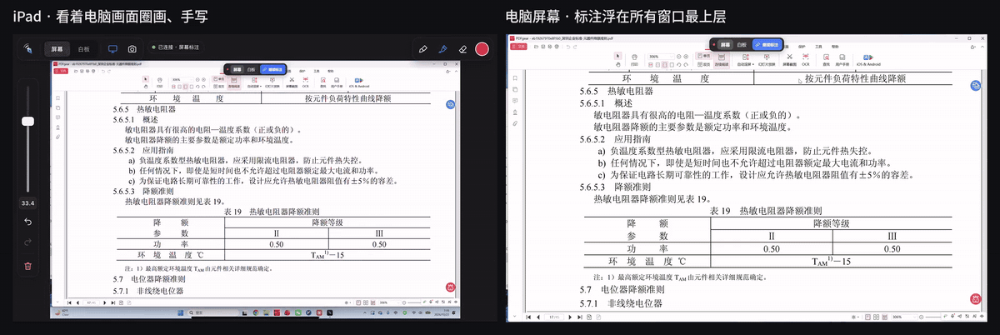

# InkCast — write on your PC screen with an iPad

**English** | [简体中文](README.zh-CN.md)

Use your iPad and Apple Pencil to annotate your Windows PC screen, or as a wireless whiteboard. Built for teaching, meetings and screencasts. Scan a QR code to connect — no iPad app, no account, no cloud: everything stays on your local network.

**Whiteboard** — write on the iPad, and it shows up in the InkCast window on the PC.



**Screen annotation** — mark up the PC screen from the iPad. Your ink floats above every window and also shows in screen recordings and meeting screen shares.



## Features

- **Screen annotation:** the iPad shows your PC screen; what you write floats above every window on the PC, and the mouse clicks through to the windows underneath.
- **Whiteboard:** write on a blank page in the InkCast window; export PNG / SVG, save and open boards.
- **Natural ink:** pressure, tapered strokes and smoothing; built-in Italic Nib and Chinese Brush pens, plus a Brush Studio to tune or create your own; highlighter and eraser.
- **Gestures:** two-finger tap to undo, three-finger tap to redo, pinch to zoom, palm rejection while writing.
- **Write with the mouse too:** the PC has the same tools as the iPad.
- **Shows in recordings and screen sharing:** OBS, Xbox Game Bar, Snipping Tool, Teams, Zoom and other meeting apps see your annotations (on by default; can be turned off in Settings).
- **8 languages:** 简体中文, 繁體中文, English, 日本語, 한국어, Deutsch, Français, Español, with a built-in illustrated user guide.

## Two ways to get InkCast

| | **Option 1: download the app (recommended)** | **Option 2: build from source** |
|---|---|---|
| For | People who just want to use it | People who want to read or change the code |
| Where | **Releases** (right-hand side) → latest release → `InkCast-<version>-windows-x64.zip` under **Assets** | The green **Code → Download ZIP** button, or `git clone` |
| What you get | The ready-to-run `InkCast.exe` and a quick-start guide | Source code only (**no** `InkCast.exe`) |
| What you need | Nothing — unzip and run | Rust and the VS C++ build tools (several GB; first setup takes 30+ minutes) |

> The “Source code (zip / tar.gz)” files that GitHub adds to every release are also source code, the same as Code → Download ZIP — not the app.

### Option 1: download the app (recommended)

1. Open the [latest release](https://github.com/Jasper6261/InkCast/releases/latest) and download `InkCast-<version>-windows-x64.zip` under **Assets**.
2. Unzip it anywhere and double-click `InkCast.exe` (no installation). If Windows shows “Windows protected your PC”, click **More info → Run anyway** (the app is not code-signed).
3. Click **Connect iPad** at the top right, scan the QR code with the iPad camera and open the link in Safari. The PC and the iPad must be on the same Wi-Fi.
4. The iPad starts on the **Board**. Tap **Screen | Board** to switch to screen annotation.

Settings and boards are stored in the `data` folder next to `InkCast.exe`. To uninstall, delete the whole folder.

### Option 2: build from source (Windows)

1. **Get the source:** click **Code → Download ZIP** and unzip it, or `git clone https://github.com/Jasper6261/InkCast.git`.
2. **Check your environment:** run `win-dev\00-env-check.bat`. It only reads; it doesn't change anything.
3. **Install the toolchain (once):** run `win-dev\01-install-toolchain.bat`. It installs Rust 1.97 and the VS 2022 C++ build tools:
   - downloads come from the official sites and are verified (SHA-256 / Microsoft signature) before running;
   - installing the VS build tools shows an administrator prompt;
   - the default location is `D:\DevTools` (or `%LOCALAPPDATA%\InkCastDevTools` without a D: drive); set `INKCAST_DEVTOOLS` to choose another folder.
4. **Build:** run `win-dev\02-build.bat`. It runs the tests, then builds `dist\wireless-whiteboard-v<version>-portable.exe`.
5. **Run:** double-click the exe and connect as in Option 1.
   - To keep settings and boards next to the exe (portable mode), create an empty file named `portable.txt` in the same folder;
   - otherwise they are stored in `%APPDATA%\com.inkcast.app`.

Or build manually (with Rust and the C++ build tools installed):

```
cd src-tauri
cargo test --locked
cargo build --release --locked
```

The app is written to `src-tauri\target\release\`.

**macOS (experimental):** build a `.dmg` with the `build-macos` GitHub Actions workflow; see `MAC.md`.

## Can't connect after scanning?

Check in this order — steps 1 and 2 fix most cases:

| # | Cause | What to do |
|---|---|---|
| 1 | A **VPN / proxy app** is running on the PC (e.g. v2rayN or Clash in TUN mode), or WSL, Docker or a virtual machine is installed. The QR code may contain a virtual adapter's address (e.g. `172.18.0.1`, `198.18.x.x`) that the iPad can't reach. | In the connect window, click **Use a different network address** and pick the one labelled **Wi-Fi / WLAN / Ethernet** (usually `192.168.…`). Don't pick one marked “virtual adapter / VPN”. |
| 2 | **Windows Firewall** is blocking it (you clicked “Cancel” on the first-run security alert, or the app was moved). | Connect window → **iPad can't open the page?** → **Allow InkCast through Windows Firewall**, click **Yes** in the administrator prompt, then reload the page on the iPad. |
| 3 | The iPad and PC are **not on the same Wi-Fi**, or on a **guest network** (guest networks usually block devices from reaching each other). | Put both on the same main Wi-Fi network. A phone hotspot also works. |
| 4 | A **VPN / proxy is on on the iPad**. | Turn it off and scan again. |
| 5 | **InkCast is already running** (in the system tray). | Only one copy runs at a time; double-clicking again just shows the running one. Right-click the tray icon → **Quit**, then start the one you want. |

## Requirements

- Windows 10 / 11 (main platform); macOS 11+ (experimental, see `MAC.md`)
- iPad with Apple Pencil, using the built-in Safari
- PC and iPad on the same Wi-Fi

## Security & privacy

- Privacy: see `PRIVACY.md` — InkCast collects no data.
- Security model and known limitations: see `SECURITY.md`. **Traffic on the local network is not encrypted; use InkCast only on networks you trust.**
- Please report security issues privately as described in `SECURITY.md`.

## For developers

**Tests**

- Rust: `cd src-tauri && cargo test --locked` (includes end-to-end tests against the real local-network server).
- Web pages (iPad page, main window, annotation layer): `node scripts/verify-browser.mjs --browser <Chromium executable> --temp <temp folder>`.

**Project layout**

| Path | Contents |
|---|---|
| `src-tauri/` | Desktop app (Rust + Tauri 2): local-network server, pairing, screen capture, annotation layer, tray |
| `src/` | PC UI: main window, annotation layer, user guide, translations, ink engine |
| `pad/` | The iPad page |
| `tests/`, `scripts/` | Browser tests |
| `win-dev/` | Windows dev scripts: environment check, toolchain install, build, firewall |
| `brand/` | Icon sources |
| `docs/` | Demo GIFs for this README |

## License

Apache License 2.0 — see `LICENSE` and `NOTICE`. Third-party licenses are in `src-tauri/THIRD_PARTY_NOTICES.txt` (also under **About › Open-source licenses** in the app). Changes are listed in `CHANGELOG.md`.
